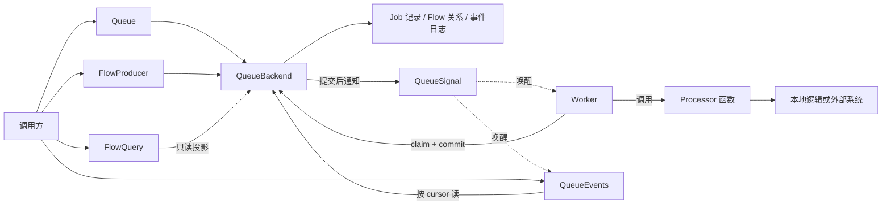

# tf_bull_mq

`tf_bull_mq` 是一个 backend-agnostic 的 Dart Job queue。参考 BullMQ 的角色划分与命名，但不绑定特定数据库、消息系统或编程语言实现。当前唯一 Backend 实现是 local + volatile 的 `MemoryQueueBackend`，适合单进程任务编排、测试和示例，同时为后续分布式或持久化 Backend 预留了完整的契约边界。

## 核心设计原则

- **队列优先**：Job 首先属于 Queue；Flow 是普通 Job 之间的依赖关系，不是另一套运行时对象。
- **角色分离**：`Queue` 只生产、`Worker` 只消费、`Job` 是轻量持久化句柄、`QueueEvents` 从事件日志观察、`QueueBackend` 是唯一事实来源、`QueueSignal` 只做低延迟唤醒提示。
- **事实只有一份**：Job 状态、Flow 关系和事件日志以 Backend 为权威；内存对象只是按需加载的句柄或执行上下文。
- **能力显式化**：Backend 必须声明 Profile 和 Capability；不支持的行为立即失败，不能静默降级。
- **至少一次执行**：通知可以丢失，但 Job 不会永久消失；Processor 必须具备幂等或外部对账能力。

## 架构概览



依赖方向单向：公共组件依赖 Backend 契约，Backend 不依赖业务 Processor；具体存储或通知产品只能出现在适配器中。

## 组件与职责

| 组件 | 角色 | 不做什么 |
| --- | --- | --- |
| `Queue` | 生产端和管理端 API：添加、查询、重试、取消、删除 Job，管理队列级策略 | 不领取 Job，不执行 Processor，不保存全部 Job 的内存副本 |
| `Job` | 轻量持久化句柄，由 `queueName + jobId` 唯一定位 | 不持有 Processor、Worker、子 Job 集合或事件总线 |
| `Worker` | 订阅 Queue、按并发 claim Job、驱动 Processor、提交结果、处理重试和协作式控制 | 不实现业务逻辑，不依赖其他 Worker 的内存状态 |
| `Processor` | 可调用契约：接收 `ActiveJob`，异步返回结果或报告失败 | 框架不解释其内部实现；复杂业务在应用层封装 |
| `ActiveJob` | 本次领取期间有效的执行上下文：更新进度/数据/日志、响应取消信号、读取依赖结果 | 执行凭证内部携带，业务代码不直接构造或修改 |
| `QueueEvents` | 按队列读取全局 Job 事件，支持 cursor 分页和 Gap 检测 | 不替代 Backend 中的事实；需要时从 Backend 读真实事件 |
| `FlowProducer` | 原子创建任意深度的父子依赖树（父子 Job 可跨 Queue） | 不读取、不修改已有 Flow |
| `FlowQuery` | 只读依赖投影：direct / recursive 后代树、加权进度、子结果 | 不写回 Backend，不把聚合结果写回父 Job |
| `QueueBackend` | 唯一事实存储，所有读写通过它完成 | 不是普通 CRUD Storage；claim 等操作必须原子提交 Job + Event |
| `QueueSignal` | 低延迟唤醒提示 | 可重复、可延迟、可丢失；不能替代 Backend 中的状态/事件/日志 |

## Job 状态模型

| 状态 | 含义 |
| --- | --- |
| `waiting` | 可以被 Worker 领取 |
| `delayed` | 尚未到达可执行时间 |
| `waitingChildren` | 父 Job 正在等待直接依赖 |
| `active` | 已被 Worker 领取 |
| `paused` | Processor 已确认协作式暂停 |
| `completed` | 执行成功（不可重激活，重复执行需创建新 Job） |
| `failed` | 执行失败且不再自动重试，或依赖最终失败 |
| `canceled` | 本次执行已取消，可手动 retry 从头执行 |

关键转换约束：
- 只有 `FlowProducer` 创建的有依赖父 Job 才能进入 `waitingChildren`。
- `completed` 不可 retry；`failed` / `canceled` 可以 retry（`canceled` retry 重置 progress、清除结束时间和失败信息，但保留身份、data 和历史 JobLog）。
- 父 Job 因依赖最终失败而失败（`failure.type == FlowDependencyFailure`）时，手动 retry 会被 Backend 拒绝；只能通过失败子 Job 被 retry 后由祖先重算自动恢复。
- 因 `forceClose` / 进程 abort 遗留的 active Job 由 Backend 自动识别并恢复（stalled 机制）。

## Backend Profile 与 Capability

### Profile（不可拆分的一致性承诺）

| Profile | 语义边界 |
| --- | --- |
| `local` | 单进程原子领取和提交；拒绝多进程同时消费；不需要租约和 fencing token |
| `distributed` | 跨进程原子领取；有期限执行租约 + 周期续租；单调 fencing token；持久化事件游标 |

### Capability（独立可缺失的特性）

```text
BackendCapabilities {
  profile:        local | distributed
  durability:     volatile | durable
  delayedJobs:    supported | unsupported
  priorities:     supported | unsupported
  atomicFlows:    supported | unsupported
  eventDelivery:  liveOnly | replayable
}
```

规则：
- Profile 与 Durability 正交：`local` 可以有 `durable` 实现，`distributed` 必然要求 `replayable` 事件。
- 能力不足时抛 `UnsupportedCapability`，不拆分执行、不静默降级。
- 当前 `MemoryQueueBackend` 声明：`local`、`volatile`、支持 delayed jobs / priorities / atomicFlows、`liveOnly` 事件。

## 投递语义

at-least-once。`QueueSignal` 只是低延迟 hint，可以重复、延迟或丢失；Worker 和 QueueEvents 都会独立 poll Backend，Backend 中的 Job、事件和日志才是事实。Processor 必须使用 `JobKey` 做幂等键，为外部副作用设计对账或恢复流程。

**恢复失败可见**：Worker 在本地被强制关闭时，Backend 会将遗留 active Job 标记为 stalled 并尝试自动恢复。如果恢复过程本身失败，Worker 会在下次 poll 时检测到该失败并保持 `closing` 状态——调用方可以通过 `Worker.close()` 返回或 `WorkerLogSink` 日志观察到恢复失败，决定是否重试 Worker 或处理受影响的 Job。

## JobLog 与 WorkerLog

- **JobLog**：按 Job 持久化的业务输出，通过 `ActiveJob.log()` 写入，`Job.queryLogs()` 分页查询。它是 Job 的业务产物，随 Job 保留或清理。
- **WorkerLogSink**：Worker 启动、连接、领取循环、续租、关闭等基础设施诊断日志，写入应用注入的 sink，不属于任何 Job 的持久化记录。
- 二者不得混用。

## Flow 语义

- `FlowProducer` 原子创建整棵依赖树（全部 Job 和关系同时可见，或全部不可见）。
- 有未完成直接子 Job 的父 Job 进入 `waitingChildren`；所有直接子 Job 成功后原子进入 `waiting` / `delayed`，再由普通 Worker 执行。
- 父 Processor 通过 `ActiveJob.getDependenciesResult<T>()` 读取直接子结果；`FlowQuery.get(depth: 'recursive')` 展开完整后代树。
- 任一子 Job 最终 `failed` 或 `canceled` 时，父 Job 进入 `failed`；`FlowQuery` 的 direct / recursive 投影和 weighted progress 让调用方看到"部分成功"，但不新增 `partiallyCompleted` Job 状态。
- 删除 Flow 根 Job 默认级联删除全部后代；待删除集合存在 active Job 时原子拒绝整个操作。

## 安装

需要 Dart SDK `>= 3.13.2`（pubspec.yaml 当前声明 `>=3.9.0`）：

```yaml
dependencies:
  tf_bull_mq: ^1.0.0
```

## 快速开始

所有公开 API 都从根库导入：

```dart
import 'dart:async';
import 'package:tf_bull_mq/tf_bull_mq.dart';

Future<void> run() async {
  var nextId = 0;
  String idGenerator() => 'job-${nextId++}';
  final backend = MemoryQueueBackend(now: DateTime.now, idGenerator: idGenerator);
  final signal = InProcessQueueSignal();
  final queue = Queue(
    queueName: 'emails',
    backend: backend,
    signal: signal,
    idGenerator: idGenerator,
    now: DateTime.now,
  );
  final events = QueueEvents(
    queueName: 'emails',
    backend: backend,
    signal: signal,
    delay: (duration) => Future<void>.delayed(duration),
  );
  final worker = Worker(
    queueName: 'emails',
    backend: backend,
    signal: signal,
    processor: (job) async => <String, Object?>{'sent': job.data},
    logSink: const SilentWorkerLogSink(),
    now: DateTime.now,
    idGenerator: idGenerator,
    delay: (duration) => Future<void>.delayed(duration),
  );
  try {
    await backend.open();
    await events.start();
    await worker.start();
    await queue.add('send-email', data: const <String, Object?>{'to': 'user'});
  } finally {
    await worker.close();
    await events.close();
    await queue.close();
    await signal.close();
    await backend.close();
  }
}

final class SilentWorkerLogSink implements WorkerLogSink {
  const SilentWorkerLogSink();
  @override
  Future<void> write(WorkerLogEntry entry) async {}
}
```

生产者通常先 `open()` Backend，再创建高层组件。默认 ownership 为 false，共享的 Backend 和 Signal 不会被任意一个 Queue、Worker、QueueEvents 或 Flow 组件关闭；由创建者按反向依赖顺序关闭组件，最后关闭 Signal 和 Backend。

## 任务数据泛型

`Queue<TData, TProgress, TResult>`、`Worker<TData, TProgress, TResult>`、`Job<TData, TProgress, TResult>` 和 `JobRecord<TData, TProgress, TResult>` 分别约束输入载荷、进度、成功结果。Backend 仍存储通用 JSON-like 数据，不把共享存储绑定到单个队列的载荷类型；类型化读取不匹配时显式抛出 `TypeError`。

```dart
final queue = Queue<String, num, int>(queueName: 'typed', backend: backend, signal: signal);
final worker = Worker<String, num, int>(
  queueName: 'typed',
  backend: backend,
  signal: signal,
  processor: (job) async {
    final String? input = job.data;
    await job.updateProgress(0.5);
    return input?.length;
  },
  logSink: logSink,
);
final job = await queue.add('length', data: 'hello');
final int? result = (await job.refresh()).result;
```

泛型不改变 JSON-like 限制：不支持直接保存自定义 Dart 对象；深度冻结后的集合仍为 `Map<String, Object?>` / `List<Object?>`，集合载荷应使用这两种类型。不同 Flow 节点使用不同类型时，使用共同上界 `Object?` 再通过 `JobRecord.cast` 读取具体节点。`JobLog` / `JobLogDraft` 支持独立日志数据泛型，`activeJob.getDependenciesResult<TChildResult>()` 独立指定子结果类型。

## 目录结构

```text
.
├── lib/
│   ├── tf_bull_mq.dart             # 公共入口，统一导出
│   └── src/
│       ├── backend/                # QueueBackend 契约及读写请求、查询模型
│       ├── core/                   # Job、事件、状态、能力、错误等领域模型
│       ├── events/                 # QueueEvents：从 Backend 读取并订阅 Queue 事件
│       ├── flow/                   # FlowProducer 创建依赖图，FlowQuery 查询及投影
│       ├── memory_backend/         # MemoryQueueBackend、内存存储和事务实现
│       ├── observability/          # WorkerLogSink 和 Worker 运行诊断日志
│       ├── queue/                  # Queue 与 Job：任务写入、查询、控制及 JobLog
│       ├── signal/                 # QueueSignal 契约及进程内唤醒实现
│       └── worker/                 # Worker 消费循环、ActiveJob、Processor 和选项
├── test/                           # 目录对应 lib/src/ 模块，integration/ 跨模块协作
├── example/                        # 完整流水线示例
├── doc/                            # 架构设计文档与实现计划
├── pubspec.yaml                    # 包元数据、SDK 约束和依赖
└── analysis_options.yaml           # Dart 静态分析配置
```

`lib/src/` 按职责拆分模块，各模块 `index.dart` 汇总对外类型；外部代码从 `package:tf_bull_mq/tf_bull_mq.dart` 导入，不直接依赖内部实现。依赖关系以 `QueueBackend` 契约为边界。

## 当前限制

- 只有 `MemoryQueueBackend` 与 `InProcessQueueSignal`；Memory backend 是 local + volatile，关闭后数据不保留。
- 尚未实现 durable adapter、distributed adapter、cron、exactly-once 语义。
- 不声称跨进程恢复或跨进程事件投递。
- 首版只提供"全部直接子 Job 成功"的 Flow 依赖策略；不支持条件分支、循环依赖、任意依赖图或可配置失败策略。

## 示例

纯 Dart 示例同时演示 Queue、Worker、QueueEvents、FlowProducer 和 FlowQuery：

```sh
dart run example/tf_bull_mq_example.dart
```
