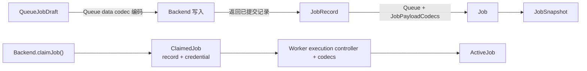
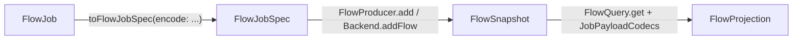

# Job 类型与转换

本文说明单个 Job 和 Flow 中常见模型的职责。核心区别是：`JobRecord` 是
Backend 的原始持久化事实；`JobSnapshot` 是业务类型化的只读投影；`Job`
和 `ActiveJob` 是供不同调用方使用的操作句柄；`FlowJob` 则是创建 Flow
时的嵌套输入。

## 类型对照

| 类型 | 用途 | 数据形态与生命周期 |
| --- | --- | --- |
| `QueueJobDraft<TData>` | `Queue.add` / `addBulk` 的单个 Job 输入草稿 | 保留业务类型；Queue 编码后交给 Backend，不代表已创建的 Job。定义见 [`queue_models.dart`](../queue/queue_models.dart)。 |
| `JobRecord` | Backend 读写的 Job 完整事实 | 非泛型；`data`、`progress`、`result` 是已冻结的 JSON-like 值，包含状态、revision、时间、执行与控制信息。读写结果以 Backend 返回的记录为准。 |
| `JobSnapshot<TData, TProgress, TResult>` | 把原始记录解码为业务类型的只读视图 | 保存 `rawRecord`，通过 `JobPayloadCodecs` 解码载荷；其他字段从记录读取。不会写 Backend，也不会自行刷新。 |
| `Job<TData, TProgress, TResult>` | Queue 调用方使用的 Job 句柄 | 持有 Backend 上下文、最近的 `JobRecord` 和对应 `JobSnapshot`；支持 refresh、retry、cancel 等操作。句柄不是权威事实，可能落后于 Backend。 |
| `ClaimedJob` | Backend 对 Worker 一次 claim 的返回值 | 临时组合 claim 后的 `JobRecord` 与 `ExecutionCredential`，供 Worker 建立受凭证约束的执行上下文。 |
| `ActiveJob<TData, TProgress, TResult>` | Processor 执行期间使用的 Job 视图 | 通过共享的执行 controller 访问最新记录和执行操作；载荷用 Worker 的 codecs 解码。不是 Queue 调用方的 `Job` 句柄。 |
| `FlowJob<TData>` | Flow 的高层嵌套输入 | 保留业务数据类型，以 `FlowChild` 组织子节点和边权重；调用 `toFlowJobSpec` 时编码并展平。定义见 [`flow_job.dart`](../flow/flow_job.dart)。 |
| `JobSpec` / `FlowJobSpec` | Backend 创建 Flow 前的输入规格 | 非泛型 JSON-like Job 输入、边和 root 标识；构造时校验整棵树。不是已持久化记录。定义见 [`flow.dart`](flow.dart)。 |
| `FlowSnapshot` | Backend 返回的 Flow 快照 | 包含 root、边以及每个节点的 `JobRecord`；提供 Flow 结构和原始 Job 事实，不负责业务载荷解码。 |
| `FlowProjection<TData, TProgress, TResult>` | FlowQuery 面向调用方的查询结果 | 将 `FlowSnapshot` 中的记录解码成 `JobSnapshot`，并按查询深度组织节点、进度、结果和失败信息。它是查询投影，不是写入模型。 |

## 转换关系

### 单个 Job

`Queue.add` 不用输入草稿伪造状态或 revision；创建句柄时使用 Backend 返回的
`JobRecord`。`JobSnapshot` 在构造时解码 `data`、`progress`、`result`，因此
Codec 解码失败会使快照创建失败，而不会生成一个成功形态的空快照。

`Job.refresh()` 从 Backend 读取新的 `JobRecord`，成功后替换当前句柄的记录和
快照。Job mutation 也以 Backend 返回的新记录替换两者；失败时保留旧快照。
不同句柄即使具有相同 `JobKey`，也各自维护缓存，不会自动同步。

Worker 的 `ActiveJob.snapshot` 根据 controller 当前的 `JobRecord` 即时构造
类型化快照。`ActiveJob` 的执行能力依赖 claim 凭证，不能用普通 `Job` 句柄替代。

### Flow

`FlowJob.toFlowJobSpec` 将嵌套节点展平为 `JobSpec` 列表和 `FlowEdge` 列表；
转换过程检查重复 key、重复节点等问题，`FlowJobSpec` 再校验 root、单父、
无环和可达性。`FlowProducer` 将每个节点的业务数据编码为 JSON-like，再由
Backend 原子创建并返回包含 `JobRecord` 的 `FlowSnapshot`。

`FlowQuery` 不修改或反写 `FlowSnapshot`：它用各节点的原始 `JobRecord` 构造
类型化 `JobSnapshot`，然后按 direct 或 recursive 深度聚合为
`FlowProjection`。因此 `FlowJob` 是创建输入，`FlowSnapshot` 是原始持久化
结果，`FlowProjection` 是读取视图，三者不能互换。

## 使用时的选择

- 需要从 Backend API 读取或写入原始事实时使用 `JobRecord`。
- Queue 调用方需要操作 Job 时使用 `Job`；读取业务载荷和当前缓存状态时使用它的 `snapshot`。
- Processor 执行任务时使用 `ActiveJob`，不要自行保存或构造执行凭证。
- 创建单个 Job 使用 `QueueJobDraft` / `Queue.add`；创建父子任务树使用 `FlowJob` / `FlowProducer`。
- 查询 Flow 的节点状态和聚合结果使用 `FlowProjection`；不要把查询投影当成 Backend 写入数据。

`JobRecord` 不保留业务泛型，业务类型仅在应用侧通过 `JobPayloadCodecs`
编码或解码；解码后的 `JobSnapshot` 不能反向替代或构造 Backend 的权威记录。
